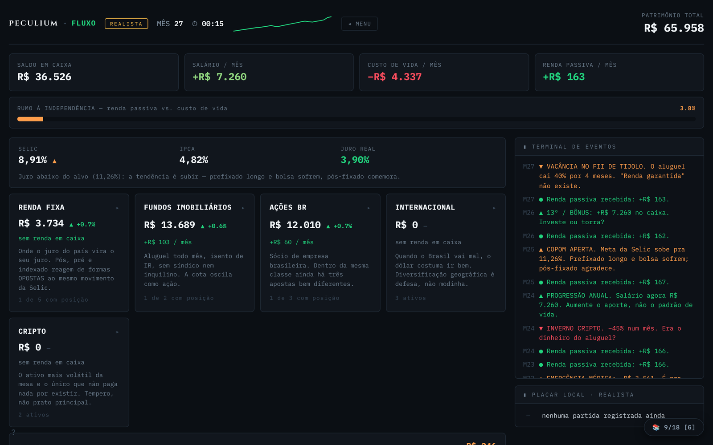
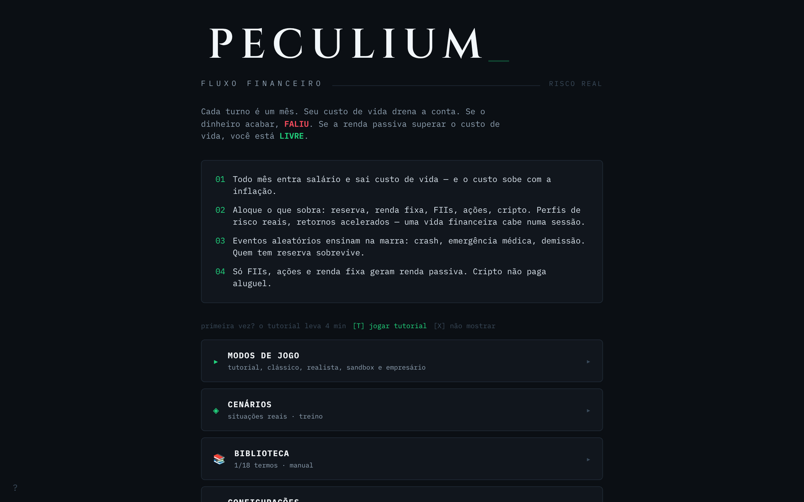
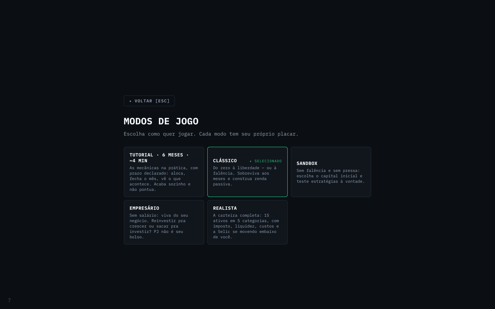
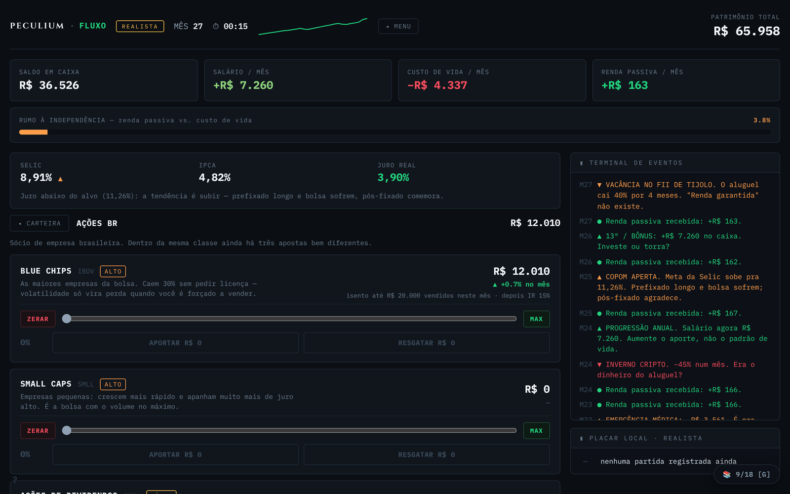
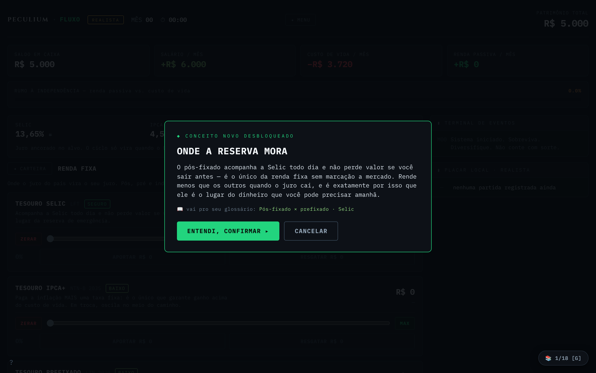
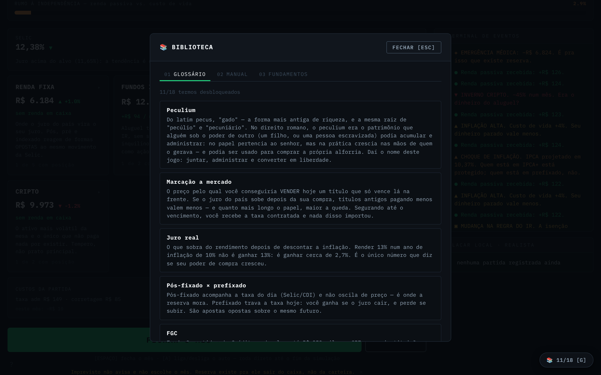
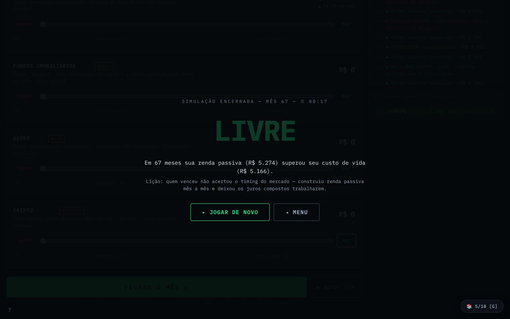

# Peculium — Fluxo Financeiro

[](https://github.com/claudiogpt/Fluxo/actions/workflows/ci.yml)
[](LICENSE)

Jogo de educação financeira por turnos, open source, que roda inteiro no navegador. Cada turno é um mês, o custo de vida drena o caixa, e o objetivo é fazer a renda passiva superar o custo de vida antes de falir. Os dois desfechos que dão o tom são **FALIU** e **LIVRE**.



> **peculium** (latim, de *pecus*, "gado"): no direito romano, o patrimônio que alguém sob o poder de outro podia acumular e administrar — e com o qual uma pessoa escravizada podia comprar a própria alforria. Juntar, administrar e converter em liberdade: é o jogo inteiro numa palavra. A versão completa é o primeiro termo do glossário.

## Jogar em 1 minuto

```bash
git clone https://github.com/claudiogpt/Fluxo.git
cd Fluxo
npm install
npm run dev        # abre em http://localhost:5173
```

Não precisa de conta, chave nem backend: o placar fica salvo no próprio navegador. Para gerar uma versão estática (qualquer hospedagem de arquivos serve), rode `npm run build` e sirva a pasta `dist/` (`npm run preview` faz isso localmente).

## Telas

| | |
|:--:|:--:|
|  |  |
| **Tela inicial**: as regras em três linhas | **Modos de jogo**: tutorial, clássico, sandbox, empresário e realista |
|  |  |
| **Carteira do modo realista**: cada ativo com risco, tributação e aporte | **Ensino no momento certo**: o primeiro aporte num ativo explica o conceito antes de confirmar |
|  |  |
| **Biblioteca**: glossário que se desbloqueia jogando, manual e fundamentos | **Fim de partida**: LIVRE ou FALIU, com a lição da partida e o placar local |

## O projeto em 30 segundos

Projeto pessoal de portfólio: **React 18 + TypeScript + Redux Toolkit sobre um engine de regras em JavaScript puro**, com 6 modos de jogo, um modo "realista" com 15 ativos, Selic e IPCA móveis, IR na venda e custos, e um glossário educacional que se desbloqueia jogando.

Decisões técnicas que valem olhar:

- **Engine puro e testável.** Toda regra do jogo vive em `engine/`, sem UI. A aleatoriedade entra por parâmetro (`rng`), nunca por `Math.random` fixo, então cada mecânica tem teste determinístico (`tests/engine.test.js`).
- **A UI não calcula nada.** Reducers embrulham o engine (clone → call → merge), selectors montam o view-model e efeitos colaterais só existem em thunks e listeners.
- **Tema verificado por teste.** Toda cor é um token em `src/tema.css`; um teste reprova o commit se aparecer cor literal no `src/` ou se o engine emitir uma cor sem token.
- **Placar online opcional e à prova de fraude.** Se você ligar o Supabase, o score é recalculado no servidor por trigger, com RLS: o cliente não consegue gravar recorde forjado.

O que aprendi construindo: separar regra de apresentação cedo é o que permitiu migrar o protótipo inteiro para React sem reescrever o jogo, e injetar a aleatoriedade é o que transformou "o jogo parece desbalanceado" em teste que dá para rodar.

## Propósito do jogo (nesta ordem)

1. **Ensinar finanças** — prioritário. Cada mecânica e evento deve deixar uma lição real de finanças pessoais/investimentos.
2. **Simulação** — secundário. A tendência é simular cada vez mais a realidade de investimentos, com decisões mais intricadas de tipos de investimento.
3. **Speedrun** — diversão. Timer e placar em **todos os modos**. Sem seed compartilhada, de propósito: o jogo é não determinístico e a sorte (e jogar de novo) faz parte da corrida.

## Como testar

```bash
node --test tests/*.test.js # engine (regras do jogo) — zero dependências, rng injetado
npx vitest run     # app React (slices, efeitos, componentes, integração por modo)
npx tsc --noEmit   # type-check
```

## Arquitetura

React 18 + Vite + TypeScript + Redux Toolkit sobre um engine de regras puro.
(O protótipo original no runtime DC foi aposentado no cutover de 2026-07 — vive no git history.)

```
engine/ (regras puras, JS/UMD)  →  src/ (React: shim → slices → selectors → componentes)
```

### `engine/` — regras do jogo, zero UI

Funções puras sobre um objeto de estado plano. UMD: `window.Fluxo.*` no browser, `module.exports` no Node (testes). **Não muda por causa de UI** — é a fonte única das regras.

| Arquivo | Responsabilidade |
|---|---|
| `config.js` | Todo o balanceamento + chaves públicas do placar online (`placarOnline`). |
| `ativos.js` | Definição dos 5 ativos (retorno, volatilidade, dividendo, risco, textos). |
| `eventos.js` | Tabela de eventos aleatórios com pesos + sorteio (filtros por modo). |
| `regras.js` | O coração: `novoJogo`, `fecharMes`, `mover`, `cobrir`, mecânicas de empresário/aposentadoria/imóveis. |
| `formato.js` | `fmt` (R$), `fmtCompacto`, `fmtTempo`, `sparkline`. |
| `placar.js` | Placar: um board por modo, em localStorage; Supabase via REST quando configurado. |
| `conceitos.js` | Dicionário central educacional: termos do glossário + tooltips e a regra de desbloqueio. |
| `catalogo.js` | Catálogo do modo **realista**: 15 ativos em 5 categorias, com indexador, prazo, tributação e custos de cada papel. |
| `realista.js` | Mecânicas do modo realista: macro viva, IR na venda, carência/vencimento e custos. `regras.js` delega pra cá quando `s.realista` existe. |

A aleatoriedade entra por parâmetro (`rng`), nunca por `Math.random` fixo — é isso que torna as regras testáveis. Semântica das transições: `fecharMes` muta e retorna o estado completo; as demais retornam parciais pra merge.

### `src/` — app React

| Pasta | Responsabilidade |
|---|---|
| `engine/` | **Shim tipado** do engine UMD: único ponto de import (`index.ts`) + tipos (`types.ts`). Aceita o branch global (browser) e o CommonJS (Vitest/build). |
| `store/` | `configureStore` + `listeners.ts` (efeitos: persistir conceitos, registrar/enviar placar, gatilhos educacionais, preferências e nick). |
| `features/game/` | `gameSlice` (reducers embrulham o engine: clone→call→merge), `selectors.ts` (view-model do jogo — ex-`renderVals`), `selectorsMenu.ts` (view-model do menu) e `cores.ts` (traduz as cores que o engine emite). |
| `features/conceitos/` | Slice do conteúdo educacional + `thunks.ts` (interceptação de 1ª vez com **ação pendente serializável**). |
| `features/placar/` | Nick, board global (thunk `carregarPlacar`) e o view-model do leaderboard. |
| `features/ui/` | Navegação do menu (`uiSlice`: pilha de rotas + glossário), os botões declarados em `menuItens.ts` e os textos da landing. |
| `features/prefs/` | Tema, família e tamanho de fonte — persistidos em `fluxo_prefs_v1` e aplicados como atributos no `<html>`. |
| `components/menu/` | As telas de menu (landing, modos, cenários, setup, configurações, perfil) e as peças reusáveis (`BotaoMenu`, `CartaoEscolha`, `GrupoOpcoes`). |
| `components/` | Telas de jogo, só-apresentação (uma por card/overlay), estilos inline. |
| `views/` | `GameView` (composição da tela de jogo). |
| `hooks/` | `useGameLoop` (tick 500ms/AUTO), `useAtalhos` (ESPAÇO/A/G/ESC/ENTER com guards) e `usePrefs`. |

**Regra de ouro**: componente não calcula regra de negócio; selector não muta; efeito colateral só em thunk/listener; o engine é dono de toda transição de estado do jogo.

### Navegação e tema

O menu é uma **pilha de rotas** no `uiSlice` (`home → modos → setup`, etc.), não um router: o app é um `index.html` estático, não há partida linkável (o jogo é não determinístico) e `game.tela` — que pertence ao engine — já decide menu vs. jogo. `ESC` sobe um nível; a pilha nunca esvazia.

O modo **realista** é o carro-chefe: carteira de 15 ativos navegada por categoria (drill-down), Selic e IPCA que se movem e arrastam os papéis com eles, marcação a mercado, IR na venda, carência e custos. Fidelidade ao mundo real ganha de balanceamento neste modo — é decisão de produto, não descuido. A regra de vitória, porém, é a mesma dos outros (renda passiva ≥ custo de vida), o que mantém o placar comparável.

Detalhe que morde: **`cenarios` é um MODO no engine** (`regras.js` só monta o cenário quando `modo === 'cenarios'`), mas na UI virou um botão de primeiro nível. Por isso `selectModosLista` esconde esse id e `escolherCenario` entra no modo junto — sem isso, escolher um cenário vindo de outro modo começaria uma partida clássica em silêncio.

Toda cor vive em `src/tema.css`, em ~38 tokens semânticos; tema, fonte e escala são atributos no `<html>` (`data-tema`, `data-fonte`, `data-escala`). Nenhum outro arquivo do `src/` pode ter cor literal — **há um teste que reprova o commit se tiver** (`features/game/cores.test.ts`), inclusive checando que toda cor emitida pelo engine tem token correspondente.

## Placar online (opcional)

Por padrão o placar é local, por dispositivo. Para ter um ranking compartilhado com seus amigos: crie um projeto gratuito em supabase.com, rode a migração `supabase/migrations/*_hardening_placar.sql` (schema + RLS + trigger que recalcula o score no servidor) e preencha `url` e `anonKey` em `placarOnline`, no `engine/config.js`. A publishable key é pública por design; a segurança é o RLS + trigger. Segredos de tooling (token do CLI, senha do banco) ficam no `.env` (gitignorado — ver `.env.example`).

Nota do free tier: o projeto Supabase **pausa após ~7 dias sem uso**. O jogo cai sozinho para o placar local, sem quebrar.

## Receitas rápidas

- **Mudar balanceamento**: `engine/config.js`.
- **Adicionar um botão no menu**: inclua o id novo em `RotaId` (`src/features/ui/uiSlice.ts`) — o `tsc` vai acusar o `Record` incompleto em `MenuRouter.tsx`, que é o seu lembrete de criar a página; depois entre com o item em `ITENS_HOME` (`menuItens.ts`). Um item com `disponivel: false` já sai como "EM BREVE".
- **Adicionar/ajustar uma cor**: `src/tema.css`, nos DOIS temas. Se a cor vem do engine (`riscoCor`, cor de log), mapeie em `src/features/game/cores.ts`.
- **Adicionar um ativo ao modo realista**: uma entrada em `engine/catalogo.js` (e a chave em `ordemLiquidacao`). A UI o exibe sozinha, dentro da categoria dele. Se o `conceito` da definição casar com um tooltip de `conceitos.js`, o 1º aporte já dispara a interceptação educacional.
- **Adicionar um modo de jogo**: entre em `config.modos` com `disponivel: false` ("EM BREVE" automático na página de modos). Mecânica: trate o `modo` em `engine/regras.js` + testes; UI: selectors em `src/features/game/selectors.ts` e, se precisar, um card novo em `src/components/`. Ajustes próprios do modo entram como mais um bloco condicional em `selectSetupPagina` + `PaginaSetup.tsx`. O placar do modo é automático se ele terminar com `s.fim`; ajuste `scoreDe` em `engine/placar.js` se a métrica não for "menos meses".
- **Adicionar um conceito educacional**: nova entrada em `engine/conceitos.js` (`tooltips` + `termos`). Gatilho por clique: intercepte com `executarComConceito` em `src/features/conceitos/thunks.ts`; gatilho por estado: adicione a condição no listener 3 de `src/store/listeners.ts`. Glossário atualiza sozinho.
- **Adicionar um ativo**: `engine/ativos.js` (+ ordem de liquidação em `config.js`). A UI o exibe automaticamente, e o card **não cresce**: a alocação é um trilho percentual (`src/components/ControleAporte.tsx`), não uma fileira de botões de valor fixo.
- **Adicionar um evento**: item com peso `p` e `run` em `engine/eventos.js` (use `modos:` pra restringir).
- **Nova regra de turno**: `engine/regras.js` (`fecharMes`) + teste em `tests/engine.test.js`; exponha na UI via selector.
- **Mexer no visual**: o componente correspondente em `src/components/` (estilos inline).

## Contribuindo

Issues e PRs são bem-vindos. Antes de abrir um PR, rode `npm test` e `npx tsc --noEmit`; o CI roda os dois.

## Licença

[MIT](LICENSE) © 2026 Cláudio Augusto
